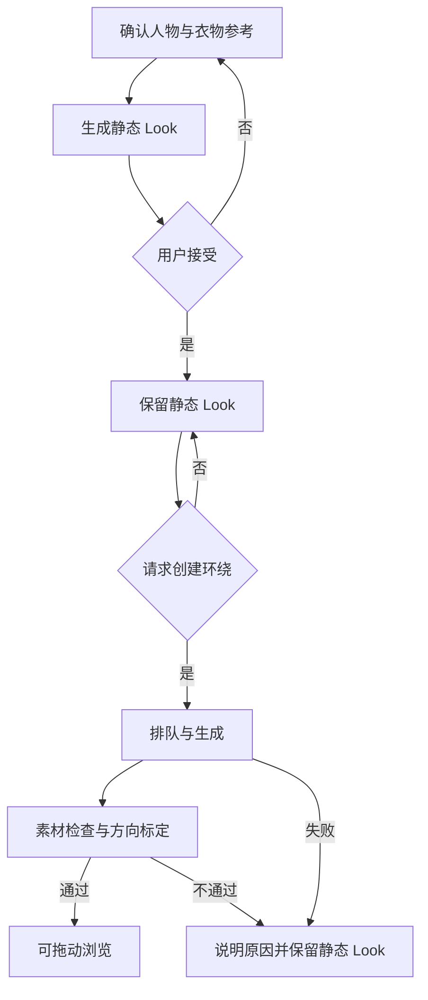

# 人物环绕

## 1. 依据与设计决定

采用 [REQ-01](../requirement/01-人物环绕.md) revision 1、[RES-01](../research/01-人物环绕.md) revision 1。首要目标是照片质感与稳定的拖动浏览，不预设必须生成网格或使用三维引擎。本文是从需求推导的设计，不是当前代码结构描述，也不作旧代码复用承诺。

主线：**人物参考 + 衣物 → 静态 Look → 用户接受 → 按需环绕 → 质量检查/方向标定 → 帧浏览**。已有合格 Look 可以缓存切换，新组合明确经历生成。照片质感不合格时返回素材阶段，不能改用低质量模型来凑转动效果。

## 2. 用户流程与状态

资源状态与任务状态分开。静态图可用时，环绕仍可能未创建、生成中或失败；供应商返回成功只表示文件产生，还要经过文件检查、视觉评审和方向覆盖确认。错误不清空用户已接受内容。

舞台保持完整头脚、稳定主体尺寸与脚底基线；背景和留白服务于人物，不照搬宣传片的手机外壳和镜头运动。普通二维控件承担单品、日期和操作。样式 token 与无障碍规范引用根 DESIGN；其历史实施说明不构成本主题效果证据。

舞台水平拖动、信息区纵向滚动；方向识别后锁定手势。正/侧/背按钮作为替代入口。松手可停帧，是否添加短惯性由样本体验决定；Reduce Motion 下无惯性和自动转动。切 Look 优先保持相同浏览方向，未预备好时不得闪出不相关帧。

## 3. 模块职责与依赖

| 逻辑模块 | 职责与依赖方向 | 对应需求 |
| --- | --- | --- |
| 输入与版本管理 | 保存人物/衣物来源、用户选择和不可变输入版本 | FR-01、NFR-05 |
| 静态试穿编排 | 将版本化输入交给供应商适配层，返回待接受 Look | FR-02、FR-05 |
| 环绕任务编排 | 仅接收已接受 Look；持久记录任务身份与状态，支持恢复 | FR-02、FR-06、NFR-07 |
| 素材处理与审核 | 文件验证、构图归一化、方向覆盖/接缝检查、生成展示资源；人工视觉接受独立保存 | NFR-01、NFR-02 |
| 资源仓储与解码缓存 | 按用户/Look/版本隔离文件；封面与方向帧加载、邻域预取、释放 | FR-04、NFR-04、NFR-05 |
| 帧浏览器 | 手势 → 浏览方向 → 查找表 → 当前版本帧；不直接提交供应商任务 | FR-03、NFR-03、NFR-06 |
| 页面状态 | 表达静态/环绕状态、接受/拒绝与错误恢复；调用用例层 | FR-02、FR-04、FR-06 |

依赖方向为页面 → 用例/浏览控制 → 资源或任务接口 → 平台/供应商适配。手势显示不依赖每次网络生成；页面不持有供应商密钥。

**代码与测试位置暂不绑定。** 本次用户明确不参考当前代码，且平台、素材与播放器尚未选定。以上均为逻辑职责，不代表存在同名模块。PLAN-01 的 T-04 必须在开发前给出经审查的准确文件和测试路径；当前没有产品代码写入范围，不预建空目录、接口或测试占位。

## 4. 资源与任务合同

| 数据 | 最小语义 | 约束 |
| --- | --- | --- |
| 人物/衣物参考 | 稳定身份、媒体版本、来源与使用范围 | 原图与生成补全分别表达 |
| Look | 人物版本、所选衣物版本及层叠顺序、静态图、接受状态 | 未接受图不自动进入环绕 |
| 环绕资源 | Look 版本、封面、帧尺寸、帧清单/源视频、方向查找表、首尾是否可循环、质量状态 | 帧数不是角度或质量证明；清单中的帧必须属于同一版本 |
| 生成任务 | 输入摘要、工作流/模型版本、供应商任务 ID、状态、错误、费用 | 超时状态未知时先查询，避免盲目重复提交 |
| 浏览状态 | 当前 Look 版本、目标方向、已显示帧、待加载状态 | 旧异步结果只能归档/释放，不得覆盖新选择 |

这是语义设计，尚非数据库 schema、HTTP DTO 或供应商 API。部署方式与具体存储在 T-04 确定；不把媒体字节、私有下载链接或密钥放入普通日志。

帧浏览算法先将横向位移映射到归一化方向，再查校准表。源素材只有按时间采样时，不显示虚假的精确角度。完整一圈和接缝都通过才能循环；否则退回素材处理或明确限制方向范围。

## 5. 播放与技术选型

首个对照优先“有界图片缓存”与“MP4 定位”。同一源素材、同一设备、同一尺寸、同一交互轨迹测试，分别记录冷加载、热缓存和快速反向。低层解码仅在观察到真实瓶颈后引入，详见 RES-01。

若首发 iOS，候选为 SwiftUI 页面 + 原生图像缓存/AVFoundation；若选 Web，候选为页面控件 + Canvas 2D。框架不是本轮已确认的产品能力；不以当前依赖或构建成功作选择理由。当前目标无需 Three.js、RealityKit 或 Unity，也不为选择帧路线自动启动改栈。

解码缓存按字节与邻域共同限制；封面先显示，再预取关键方向和手势邻域。解码结果带资源版本和请求序号；停止使用时取消待办并释放完成结果。后台停止绘制，恢复时检查资源状态。性能目标和内存上限在真机协议中固定后才评判，不从发布视频 FPS 推断。

## 6. 风险、回退与待决

| 风险 | 处理 |
| --- | --- |
| 连续视频换脸、衣纹漂移、缺失背面 | 静态/环绕分别验收；要求补参考或标明推测，失败保留静态图 |
| 环绕失败仍被标记为可浏览 | 分离供应商完成、文件可读与视觉接受状态 |
| MP4 seek 抖动或图片缓存超限 | 同素材对照选择，不先承诺某一播放器；失败可回到静态展示并明确无环绕 |
| 多件串行换装累积错误 | 固定人物参考，限定品类并比较多参考整套生成；保留非目标区域检查 |
| 切 Look 后旧任务覆盖 | 以不可变输入版本和当前浏览请求匹配 |
| 旧 GLB/三维规定被误用为需求 | 本主题以当前用户目标为准；开发前将目标平台中的冲突说明单独对齐 |

待决：平台/最低设备、样本接受标准的实际参考、供应商与数据条款、预算/重试上限、可循环素材规范及精确性能协议。下游 [PRD-01](../prd/01-人物环绕.md) revision 1 定义验收，[PLAN-01](../plan/01-人物环绕.md) revision 1 控制进入开发的条件。

[知识库首页](../README.md)
