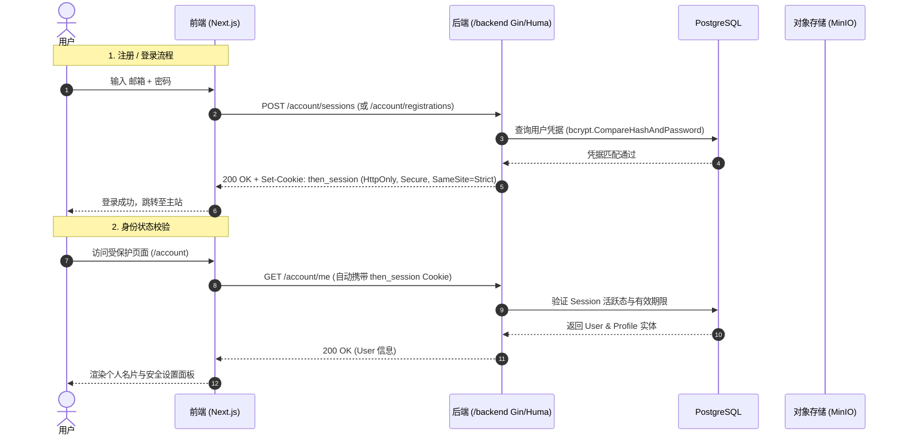

# 用户账户与认证系统设计 (Vercel & Google Go 双规范落地版)

## 1. 依据与核心设计决定

采用 [REQ-03](../requirement/03-用户账户与认证.md) 与 [PRD-03](../prd/03-用户账户与认证.md)。
本设计旨在构建支撑 Woo / Wearlog 穿搭走秀台与数字衣橱的高安全用户体系，严格遵循以下工业级工程标准：
* **前端工程**：遵循 **Vercel 设计规范与 Next.js App Router 最佳实践**（Server-First 路由骨架、客户端表单就地校验、无闪烁重定向、HttpOnly Cookie 免前端操作）；
* **后端工程**：遵循 **Google Go Style Guide（Google Go 设计规范）**（接口隔离、Context 显式传递、显式错误包裹、bcrypt 密码安全散列、参数化防注入）。

### 核心架构原则
1. **纯粹极简的凭据认证**：严格采用邮箱 + 强密码，由服务端 Set-Cookie 交付 `then_session`，杜绝 LocalStorage 明文存储 Token 引发的 XSS 盗号风险；
2. **租户级资产隔离与短时签名防盗链**：
   - 领域层所有查询强制绑定当前用户的 `user_id`；
   - MinIO 对象存储采用私有 Bucket，由后端通过 S3 兼容 SDK 签发 1 小时只读签名链接，彻底封堵公网直链盗刷。

---

## 2. 系统拓扑与认证流

---

## 3. 模块职责与代码落点

| 职责模块 | 代码落点 | 技术实现与规范要求 |
| :--- | :--- | :--- |
| **登录与注册页面** | `frontend/src/app/(site)/login/page.tsx` `frontend/src/app/(site)/register/page.tsx` | Server Component 骨架，统一使用 `AuthForm`，就地字段校验 |
| **账户管理中心** | `frontend/src/app/(site)/account/page.tsx` | 个人名片维护、Handle 设置、活跃会话列表、注销申请 |
| **会话与认证 Hook** | `frontend/src/hooks/account/` | `useCurrentUser`、`useAccountActions`（TanStack Query 封装） |
| **账户领域服务** | `backend/internal/application/account/` | 邮箱密码认证、Session 创建校验、Handle 乐观锁、注销清扫 |
| **隐私声明领域服务** | `backend/internal/application/privacy/` | 成年肖像声明确认与撤回状态管理 (`self-adult-v1`) |
| **账户 HTTP API** | `backend/internal/adapter/httpapi/` | `account_contract.go`、`account_handlers.go`、`account_routes.go` |
| **GORM 账户持久化** | `backend/internal/adapter/postgres/` | `account.go`，用户凭据、Session、Profile 实体映射与事务保证 |

[知识库首页](../README.md)
