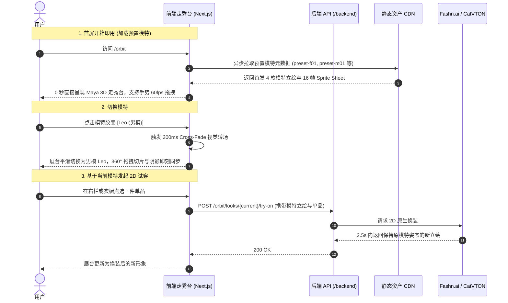

# 预置虚拟模特与试穿人像系统设计 (Vercel & Google Go 双规范落地版)

## 1. 依据与核心设计决定

采用 [REQ-04](../requirement/04-预置虚拟模特与试穿人像.md) 与 [PRD-04](../prd/04-预置虚拟模特与试穿人像.md)。
本设计旨在构建支撑 Woo / Wearlog 穿搭走秀台冷启动与高保真试穿的模特载体体系，严格贯彻两项工程规范：
* **前端工程**：遵循 **Vercel 设计规范与 Next.js App Router 最佳实践**（Geist 视觉体系、轻量级胶囊单选组件、Cross-Fade 视觉转场、CLS=0 固定 3:4 容器）；
* **后端工程**：遵循 **Google Go Style Guide（Google Go 设计规范）**（无包级全局状态、Context 传递、面向接口装配、资源清理与超时保护）。

### 核心架构原则
1. **预置资产 CDN 边缘加速**：预设虚拟模特的立绘、透明抠图与 16 帧 Sprite Sheet 采用静态化预渲染与 CDN 强缓存，完全不占用动态数据库读写与服务器推理算力；
2. **轻量解耦的模特选择器**：模特选择作为中栏走秀台的顶部控件（`MannequinSelector`），通过受控状态驱动主展台 `RunwayStage`，与侧边栏历史 Look、右侧单品解构栏保持纯净的数据流通信。

---

## 2. 模特加载与试穿时序流程

---

## 3. 模块职责与代码落点

| 职责模块 | 代码落点 | 技术实现与规范要求 |
| :--- | :--- | :--- |
| **模特切换器组件** | `frontend/src/components/orbit/mannequin-selector.tsx` | 水平轻量胶囊单选组，支持预设模特与自定义照片切换 |
| **预置模特静态配置** | `frontend/src/lib/orbit/preset-mannequins.ts` | 静态声明 4 款首发预置模特的名称、风格、立绘与 Sprite Sheet CDN 地址 |
| **本人照片上传抽屉** | `frontend/src/components/orbit/person-photo-drawer.tsx` | 头脚完整度质检，88% 接地参考线自动对齐与裁剪 |
| **走秀主舞台** | `frontend/src/components/orbit/runway-stage.tsx` | 固定 3:4 比例容器，平滑过渡承接当前模特立绘与 Canvas 拖拽器 |
| **试穿服务提供者** | `backend/internal/adapter/orbitproviders/` | `TryOn` 接口调用 Fashn.ai / CatVTON 实现基于模特立绘的原生姿态换装 |

[知识库首页](../README.md)
